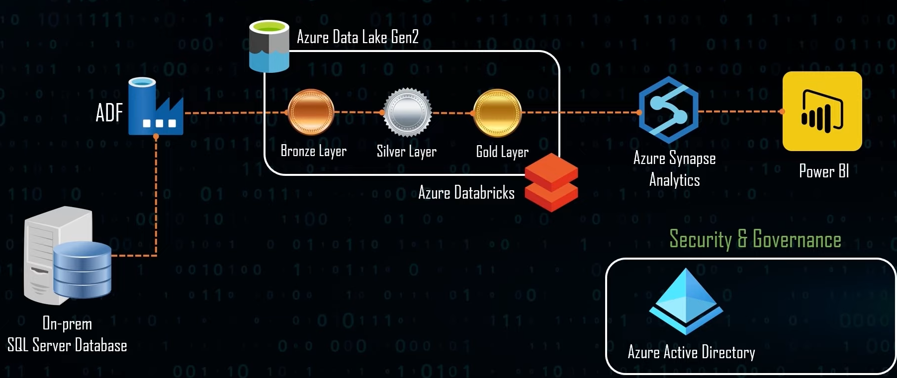
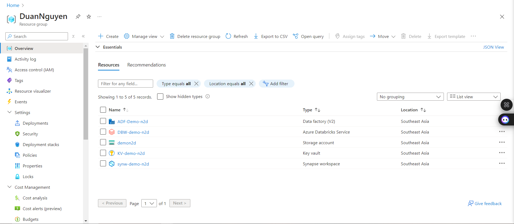

# End-to-End Data Engineering Project Using Azure Technologies

This repository is my implementation of an end-to-end **Azure Data Engineering** project, built by following the **Mr. K Talks Tech** YouTube tutorial series (see [References](#references)). It is a learning project: the committed artifacts are the Azure Data Factory resources in [`adf/`](adf/README.md), a Power BI file, and screenshots.

---

## **Project Overview:**
The goal is to migrate data from an **on-premise SQL Server** database (AdventureWorksLT, `SalesLT` schema) to the **Azure cloud**, transform it, and analyze it. The project follows a **medallion (Bronze / Silver / Gold) architecture**, using **Azure Data Factory**, **Azure Databricks**, **Azure Data Lake Gen2**, **Azure Key Vault**, and **Power BI**.

### What is in this repo (and what is not)
- **Included:** ADF pipelines, datasets, linked services, a self-hosted integration runtime definition, and a daily schedule trigger (`adf/`); a Power BI file (`Awlt.pbix`); screenshots.
- **Not included:** the Databricks notebooks. The pipeline calls `/Shared/DefaultToSilver` and `/Shared/SilverToGold` in the Databricks workspace, but those notebooks were never exported here. [`adf/README.md`](adf/README.md) has short sample code showing the idea for one table.
- **Not implemented:** loading into Azure Synapse Analytics. The tutorial covers Synapse, but nothing in `adf/` references it. The flow diagram below shows the tutorial's full target architecture (including Synapse and Azure Active Directory), not only what is implemented here.

## **Use Case: On-Premise SQL Database Migration**
The project simulates one of the most common real-world scenarios: **migrating an on-premise SQL Server database to the cloud**. The database consists of six or seven tables, which are copied to **Azure Data Lake Gen2** using **Azure Data Factory**.

The full Azure Data Factory implementation (pipelines, datasets, linked services, triggers) is in [`adf/`](adf/README.md).

I can't public my azure resource group

---

### **Architecture Workflow:**
1. **Data Ingestion**:
   - Using **Azure Data Factory** and a **self-hosted integration runtime**, a Lookup activity lists every table in the `SalesLT` schema, and a ForEach + Copy activity writes each table as **Parquet** into the `awlt2019` container (**Bronze layer**) in Azure Data Lake Gen2.

2. **Bronze, Silver, and Gold Layers**:
   - The **Bronze layer** holds raw data, serving as the **source of truth**.
   - The **Silver layer** is where basic modifications (date formatting) are applied by a Databricks notebook.
   - The **Gold layer** holds the renamed (snake_case) columns, ready for analytics and reporting.

3. **Data Transformation**:
   - After the copy step, ADF runs two **Azure Databricks** notebooks in sequence (`/Shared/DefaultToSilver`, then `/Shared/SilverToGold`) on an existing cluster. The notebooks are PySpark but are **not committed** to this repo.

4. **Data Reporting**:
   - [`Awlt.pbix`](Awlt.pbix) is a sample Power BI report on the AdventureWorksLT data.
   - *Not implemented:* the tutorial's step of loading Gold into **Azure Synapse Analytics** and pointing Power BI at Synapse.

5. **Security**:
   - **Azure Key Vault** stores the on-premise SQL Server password; the `OnPremSQLServer` linked service reads it as a Key Vault secret.

6. **Automation**:
   - A **schedule trigger** runs the whole pipeline once a day at 00:00 (SE Asia Standard Time).
   - Each run is a **full reload** (`SELECT * FROM <schema>.<table>` for every table). There is no watermark, change data capture, or event trigger, so this is batch, not real-time.

---

### **Key Concepts Covered:**
- **Data Lakehouse Architecture**: Understanding the **Bronze**, **Silver**, and **Gold** layers for data storage and transformation.
- **Batch orchestration with ADF**: metadata-driven copy (Lookup + ForEach), chaining Databricks notebooks, scheduled triggers.
- **Hybrid connectivity**: reading an on-premise SQL Server through a self-hosted integration runtime, with secrets in Key Vault.
- **Power BI**: building a report on the curated data.

---

### **Useful for:**
- Data Engineers looking to enhance their skills with Azure tools.
- Professionals preparing for data engineering interviews.
- Anyone looking to understand real-world use cases for data lakehouse architectures in Azure.
  
---

### **References:**
- This project follows the tutorial series by the YouTube channel **Mr. K Talks Tech**. The architecture and pipeline design follow that tutorial; this repo is my own run-through of it.
